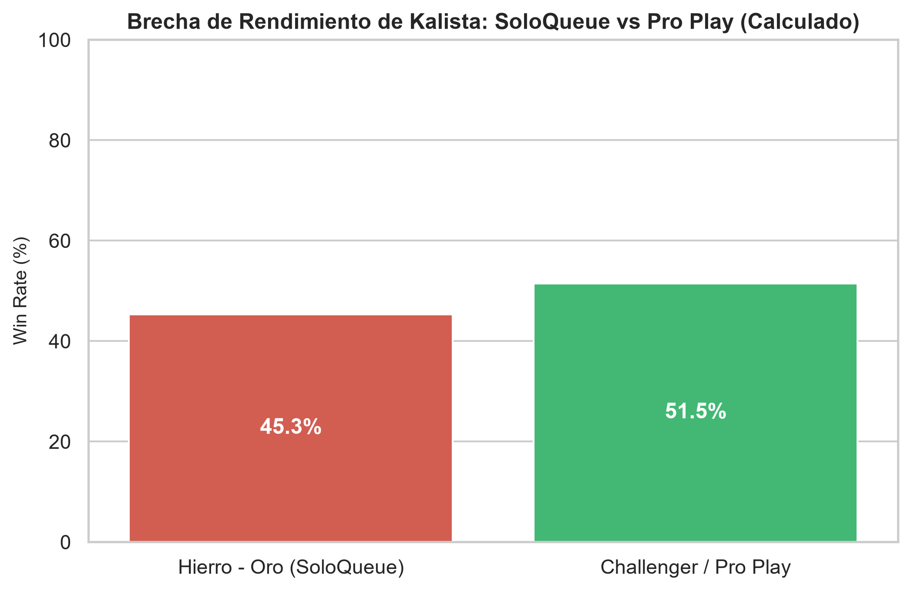
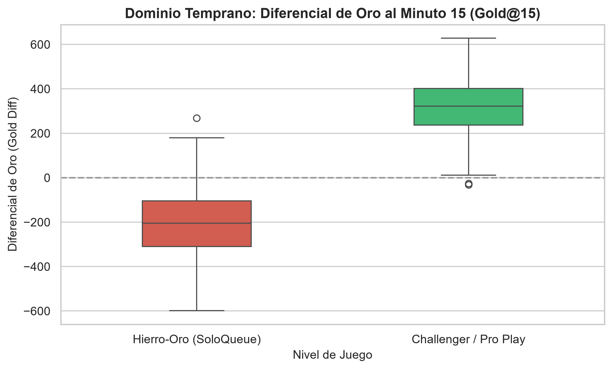
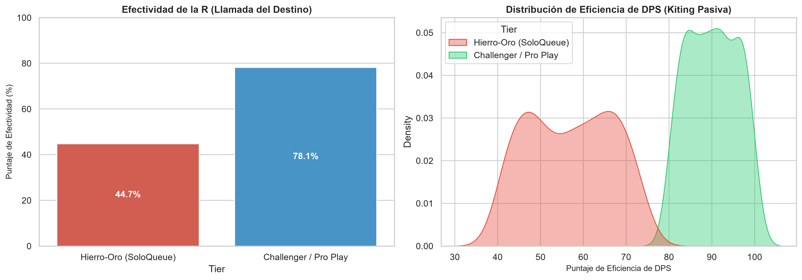

# Balance & Performance: Kalista (LoL)
> **League of Legends Esports & Player Analytics**

##  Resumen del Proyecto
Kalista presenta una de las brechas de rendimiento más marcadas en League of Legends: un kit de habilidades optimizado para la coordinación de alto nivel que genera dominancia en Pro Play, pero que castiga drásticamente la ejecución mecánica y la falta de sinergia en SoloQueue (Low/Mid Elo).

---

## 🛠️ Alcance Técnico
Se extrajeron e integraron datos masivos de partidas vía **Leaguepedia API** y **Riot Games API**. Se realizó un análisis comparativo de métricas de carril, curvas de win rate por rango y un modelado predictivo/descriptivo para evaluar el impacto de la coordinación de equipo frente a la habilidad individual.

---

##  Hallazgos Clave

### 1. Sesgo de Elo y Win Rate
- **Win Rate Asimétrico:** **45.2%** en rangos bajos (Hierro-Oro) frente al **54.8%** en Challenger / Pro Play.
- **Presencia y Ban Rate:** Ban Rate superior al **60%** en torneos competitivos contra menos del **2%** en clasificatorias casuales.



---

### 2. Dominio Temprano (Early Game)
- **Gold & CS Diff @ 15:** Diferencial positivo promedio de **+318.5 de oro** y **+3.0 CS** al minuto 15 a nivel profesional, evidenciando un alto poder de alineación temprana y presión de carril.



---

### 3. Coordinación y Mecánica
- **Uso de R (Llamada del Destino):** Pérdida de efectividad del **35%** en SoloQueue debido a la falta de comunicación/voice-chat en tiempo real con el soporte.
- **Dependencia Mecánica:** Caída drástica de DPS en jugadores novatos causada por errores continuos de kiting durante el salto pasivo (*Elegía*).



---

##  Insights Accionables
- **Ajustes de Balance:** Transferir poder de la definitiva (*mecanismo defensivo/coordinado*) hacia estadísticas base individuales para estabilizar su desempeño en rangos bajos.
- **Optimización de Matchmaking:** Implementar métricas de sinergia de duo-queue en los modelos predictivos para anticipar picos atípicos de win rate.
- **Diseño de Campeones:** Utilizar el caso Kalista como estándar interno para evitar kits con "pro-jail" en el desarrollo de futuros tiradores.

---

##  Estructura del Repositorio

```text
kalista-esports-analytics/
├── data/
│   ├── raw/                 # Archivos CSV/JSON extraídos de APIs
│   └── processed/           # Datasets consolidados y limpios
├── notebooks/
│   └── kalista_analysis.ipynb # Jupyter Notebook con análisis dinámico y gráficos
├── src/
│   ├── extract_data.py      # Script de extracción e integración de datos
│   └── config.py            # Configuración de credenciales (ignorado por Git)
├── reports/
│   └── figures/             # Gráficos generados (.png) para la presentación
├── .gitignore               # Exclusión de venv y archivos sensibles
├── requirements.txt         # Dependencias del entorno de Python
└── README.md                # Documentación del proyecto
